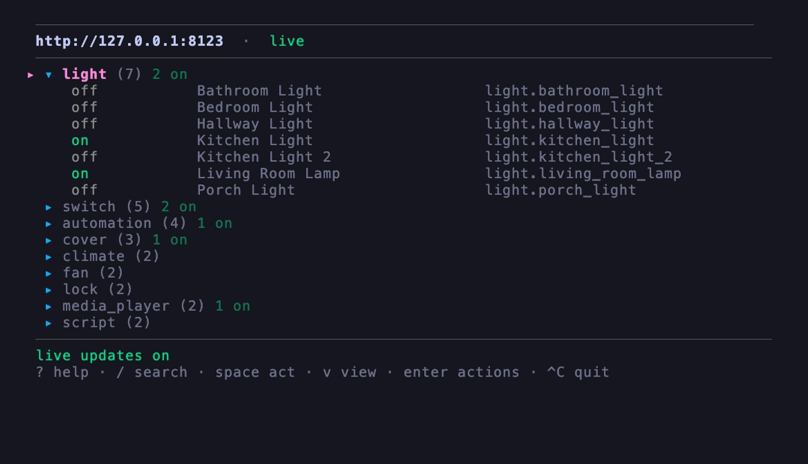

# home-assistant-cli (`has`)

A small command-line client for [Home Assistant](https://home-assistant.io).
Control devices and check state; nothing more.



## Install

```sh
brew install ynui/tap/home-assistant-cli
```

If another tool already owns the `has` name, run `brew unlink has` first.
Other options: `go install github.com/ynui/home-assistant-cli@latest`,
`make install` from a checkout, or a binary from the
[releases](https://github.com/ynui/home-assistant-cli/releases).

## Setup

Get a long-lived access token from your HA profile (open `<url>/profile`),
then:

```sh
has login
```

It asks for the URL and token, checks they work, and saves them to
`~/.config/has/config.json`. Run it again to replace a token.

## Commands

```
has groups                        # domains and how many entities each has
has list [selector...]            # [--sort entity|name|state|changed] [--area name]
has get <entity>                  # one entity, with attributes
has on|off|toggle <selector...>   # [--all] [--dry-run] [--area name]
has call <domain.service> [entity...] [k=v...] [--all] [--dry-run]
has history <entity...>           # state changes, [--since 7d]
has logbook [selector...]         # events incl. automations, [--day today]
has watch [selector...]           # state changes as they happen
has services [pattern]            # what can be called; one match lists its fields
has template <jinja>              # render a template (stdin if omitted)
has ui                            # the interactive client
has version
```

Global flags: `-o table|json`, `--url`, `--token`, `--timeout`.

## Selectors

An exact id, a domain, or a piece of the id or name:

```sh
has list light.kitchen_light   # exact id
has list lights                # whole domain
has list kitchen               # anything with "kitchen" in id or name
```

Reads accept many matches. Writes refuse more than one unless you pass
`--all`; `--dry-run` shows what would be affected without calling.

`has call` names entities in position, mixed with key=value arguments in
either order:

```sh
has call light.turn_on "Living Room Lamp" brightness=255
has call light.turn_on brightness_step_pct=10 "Living Room Lamp"  # brighter
has on --area living --all light    # every light in an area, all at once
```

## Scripting

Results go to stdout, warnings to stderr, so output can be piped and captured.
`-o json` works on every command. Exit codes: `0` ok, `1` error, `2` bad
command line, `3` selector matched nothing or too much, `4` token refused,
`5` server unreachable. `HAS_URL`, `HAS_TOKEN` and `HAS_CONFIG` override the
saved config; flags override them.

## The TUI

`has ui` shows entities you can act on; search (`/`) reaches every entity.
Key bindings:

| key | action |
|---|---|
| `/` | search |
| `↑`/`↓`, `pgup`/`pgdn`, `home`/`end` | navigate |
| `←`/`→` | fold / unfold group |
| `enter` | open group, or open action menu |
| `space` | run main action |
| `1`-`9` | run that action (menu open) |
| `f` | pin/unpin favorite |
| `h` | hide entity (same key unhides) |
| `H` | list hidden entities |
| `v` | change grouping: groups, areas, states, flat |
| `ctrl+d` | entity attributes panel |
| `alt+↑`/`alt+↓` | move group or favorite |
| `ctrl+a` | show/hide read-only entities |
| `ctrl+u` / `ctrl+r` | clear search / refresh |
| `?` | help |
| `esc` | close panel, search, or group |
| `ctrl+c` | quit |

The header shows whether the connection is `live` (WebSocket) or `polling`;
it reconnects on its own. Saved in `~/.config/has/ui.json`: favorites, hidden
entities, group order and view. Hidden entities still turn up in search; `H`
is the list of them. Groups always start folded; `--expand` opens them all.

## Development

```sh
make                        # format, check, lint, test, build
make run ARGS="list kitchen"
```

`demo/fakeha` is a fake Home Assistant for testing without a real house:

```sh
make build
go run ./demo/fakeha &
HAS_URL=http://127.0.0.1:8123 HAS_TOKEN=demo ./bin/home-assistant-cli ui
```

`make demo` re-records `demo/demo.gif`.

## License

MIT — see [LICENSE](LICENSE).
